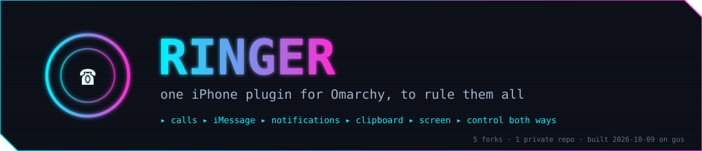
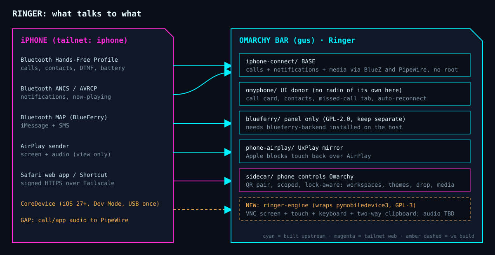

# Ringer

One iPhone plugin for Omarchy, assembled from the best of the plugins.omarchy.org catalog.
For Fred only. Private. Named by Fred 2026-10-09. Project dir stays iphone.control.in.omarchy (session dir).

## Parts (full-history subtrees, each tracking its upstream)

| Dir | Source (our fork) | Role |
|---|---|---|
| `iphone-connect/` | nixfred/omarchy-iphone-connect (Badr-Emil, MIT) | BASE. Calls, contacts, recents, DTMF, notifications, now-playing, battery, noise suppression, all over Bluetooth HFP + PipeWire telephony. No app on the phone. |
| `omyphone/` | nixfred/omyphone (boyidzham, MIT) | Borrow: call card, contacts and missed-call UI, reconnect logic. Tested on iPhone 13. |
| `sidecar/` | nixfred/omarchy-sidecar (mtolhuys, MIT) | iPhone controls Omarchy: QR pairing, tailnet only, lock-aware workspace / theme / drop / media. |
| `phone-airplay/` | nixfred/omarchy-phone (AdamMusa, MIT) | View the iPhone screen via UxPlay AirPlay (view-only, Apple blocks touch). |
| `blueferry/` | nixfred/omarchy-blueferry (erikwb, GPL-2.0-only) | iMessage/SMS panel. Needs the separate blueferry-backend. Kept as a dependency, not merged, because of the GPL. |

## The engine: pymobiledevice3 CoreDevice (not in the catalog, so Ringer wraps it)
Target (Fred, 2026-10-09): the last 2-3 iPhones on the latest iOS. iOS version and model are NOT a question; assume iOS 27+, which is the gate for remote control.
`pymobiledevice3` (doronz88, 2.8k stars, v11.26.0 on 2026-10-08, **GPL-3.0**) speaks Apple's own CoreDevice protocol, same as Xcode's Device Hub. No Mac, no jailbreak, no WDA, no signing. Verified in source 2026-10-09:
- **Screen + touch + keyboard**: `developer core-device display serve-vnc` (bind `--host 127.0.0.1`) + `universal-hid-service tap|drag|swipe|type`.
- **Clipboard, both ways**: `pasteboard_service.py` (PULL, SET, AUTONOTIFY change events, text and images) and `serve-vnc --share-clipboard`. Caveat: a copy from Apple Notes can stall the device pasteboard for about 64 s.
- **Audio**: decode exists (`aac_eld.py`) but the player is macOS-only, so Ringer must route it to PipeWire. This is the main thing left to build.
- Setup: Developer Mode on the phone, one USB pairing, then the Wi-Fi tunnel. Wireless is unverified on a Linux host.
- GPL-3.0: keep it an external dependency (`uv tool install pymobiledevice3`; the AUR package is stale). Never vendor its code into the MIT subtrees.

## Decisions (Fred, 2026-10-09)
- Fork 5, subtree into one private repo (not all ~11).
- Remote control means BOTH directions.
- Device target: last 2-3 iPhones on latest iOS; no per-version support matrix.

## Git rules
- `origin` = nixfred/ringer (PRIVATE).
- `upstream-*` remotes are fetch-only, push URL DISABLED. Never push to a source repo.
